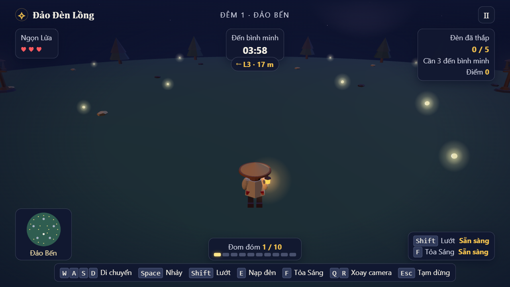

# Đảo Đèn Lồng

[Video demo và bản tải xuống v1.0.0](https://github.com/SonVinUni/K5-L3A-DAY12-VoSyThaiSon-2A202603623-AI-SDLC-Dao-Den-Long/releases/tag/v1.0.0)

Game 3D góc nhìn thứ ba. Giúp Mây giữ đủ đèn sáng tới bình minh trên Đảo Bến, Đảo Cau và Đảo Chuông.



## Chạy game

Cần Node.js 22.12 trở lên và trình duyệt có WebGL 2. Từ gốc repo, chạy:

```sh
npm ci
npm run build
npm start
```

Mở `http://127.0.0.1:4173/` nếu trình duyệt chưa tự mở. Chọn **Bắt đầu → Chơi ngay**. Nếu đã tải bản ZIP từ Release, giải nén và chạy `node scripts/run.mjs` trực tiếp.

| Phím mặc định | Hành động |
|---|---|
| WASD hoặc mũi tên | Di chuyển |
| Space | Nhảy |
| Shift | Lướt |
| E | Nạp ánh sáng hoặc châm dầu |
| F | Tỏa Sáng, tốn 3 đom đóm |
| Q, R hoặc kéo khung 3D | Xoay camera |
| Esc hoặc P | Tạm dừng |

Cài đặt có đổi phím, giảm chuyển động, chữ lớn ×1,25 và bảng màu dễ phân biệt. Hình ảnh trên màn hình báo Bóng Mực xuất hiện, gió, đèn ít dầu và 10 giây cuối.

Thắp đèn mới cần 10 đom đóm, thắp lại cần 5. Đèn từ 30 dầu trở lên tạo vùng an toàn. Thắng khi còn sống đến bình minh với đủ 3/5, 4/6 hoặc 5/7 đèn sáng. Nạp mỗi đom đóm được 5 điểm. Thắp mới được 100, thắp lại 40. Tỏa Sáng trúng một Bóng Mực được 5 điểm hoặc 15 nếu nó đang hút dầu. Khi thắng, mỗi đèn sáng cho 50 điểm cộng phần nguyên lượng dầu và mỗi Ngọn Lửa còn lại cho 50 điểm. Bảng xếp hạng chỉ cộng điểm các đêm đã thắng.

## Kiểm thử, headless và hiệu năng

```sh
npm test
node src/headless.js --seed 42 --night 1 --inputs tests/inputs/move-forward.json --ticks 1 --snapshot-every 1 --out move-smoke.jsonl
node scripts/bench.mjs --seed 42 --duration 30 --out bench.json
node scripts/soak.mjs --seed 7 --nights 10 --out soak.json
node scripts/run.mjs --export-leaderboard out.json
```

Headless nhận `--night 1|2|3` và tùy chọn `--scenario <file.json>`. Benchmark cần màn hình và Chromium. Trên Windows có thể dùng Microsoft Edge sẵn có. Nếu máy benchmark chưa có Chrome/Edge tương thích, chạy `npx playwright install chromium` trước. Có thể đặt `DAO_BENCH_BROWSER=chrome` để chọn Chrome đã cài.

Benchmark dùng khung 1280×720, 200 Bóng Mực, 100 đom đóm và 3 đèn đủ dầu. Đo sau 3 giây khởi động và đợi WebGL hoàn thành từng khung. Launcher yêu cầu tắt giới hạn khung và GPU VSync qua cờ Chromium. Trang web không xác nhận trực tiếp được trạng thái VSync nên file ghi `vsync_off: false`. RSS của trình kết xuất web cũng không có số đo tin cậy trong trang, nên `peak_mem_mb` ghi `null`. Soak đo RSS trực tiếp của tiến trình Node.

Bảng xếp hạng lưu tại `~/.dao-den-long/leaderboard.json`. Biến `DAO_DEN_LONG_LEADERBOARD` đổi đường dẫn cho cả web cục bộ và lệnh xuất. File đầu ra có danh sách `entries` theo thứ hạng.

Xem [Contract v1.3](game.contract.json), [bằng chứng Phase 4](docs/proof/phase-4/README.md) và [retro](docs/retro.md).

## Sáng tạo của tôi

Bản đồ nhỏ giúp tìm đèn, đom đóm và Bóng Mực. Biển mây, sao và quầng sáng đổi theo tiến độ. Chế độ benchmark dùng cảnh Đêm 1 chuẩn và bỏ bản đồ nhỏ cùng HUD. CLI kiểm tính tất định bằng hai file JSONL giống từng byte.
